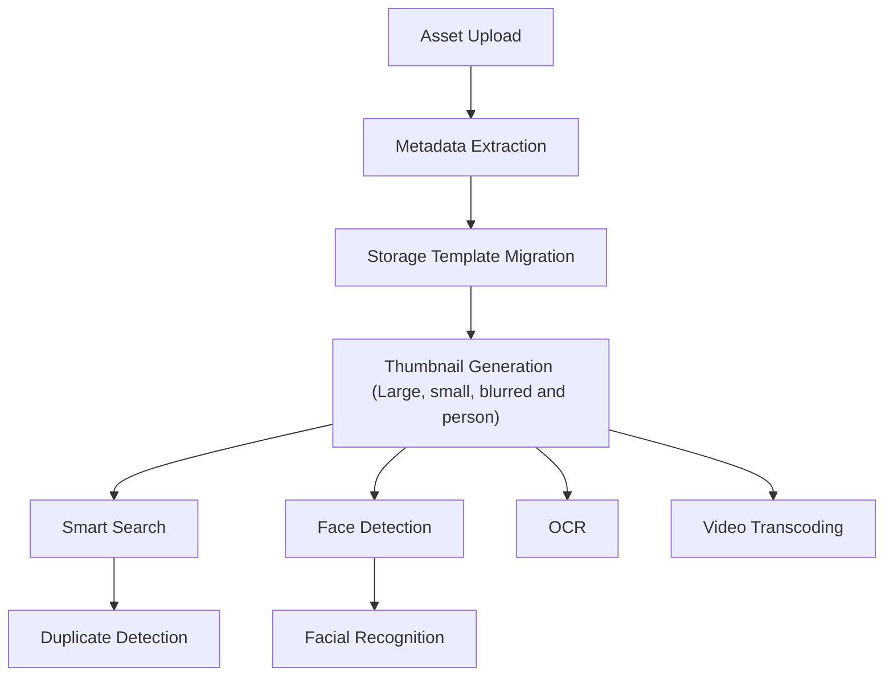

# Jobs and Workers

## Workers

### Architecture

The `immich-server` container contains multiple workers:

- `api`: responds to API requests for data and files for the web and mobile app.
- `microservices`: handles most other work, such as thumbnail generation and video encoding, in the form of _jobs_. Simply put, a job is a request to process data in the background.

Each worker runs in a process of its own. When the `microservices` worker crashes, for example because the server ran out of memory, the `api` worker goes on serving the web and mobile app, and the `microservices` worker starts again after a second, waiting twice as long after each crash in a row, up to a minute. On Linux the `microservices` worker raises its [OOM score](https://man7.org/linux/man-pages/man5/proc_pid_oom_score_adj.5.html) (`oom_score_adj` 500), which the programs it runs (ffmpeg, exiftool) inherit, so that when memory runs out the kernel stops background work rather than the `api` worker.

## Split workers

If you prefer to throttle or distribute the workers, you can do this using the [environment variables](/install/environment-variables) to specify which container should pick up which tasks.

For example, for a simple setup with one container for the Web/API and one for all other microservices, you can do the following:

Copy the entire `immich-server` block as a new service and make the following changes to the **copy**:

```diff
- immich-server:
-   container_name: immich_server
...
-   ports:
-     - 2283:2283
+ immich-microservices:
+   container_name: immich_microservices
```

Once you have two copies of the immich-server service, make the following changes to each one. This will allow one container to only serve the web UI and API, and the other one to handle all other tasks.

```diff
services:
  immich-server:
    ...
+   environment:
+     IMMICH_WORKERS_INCLUDE: 'api'

  immich-microservices:
    ...
+   environment:
+     IMMICH_WORKERS_EXCLUDE: 'api'
```

## Jobs

When a new asset is uploaded it kicks off a series of jobs, which include metadata extraction, thumbnail generation, machine learning tasks, and storage template migration, if enabled. To view the status of a job navigate to the Administration -> Jobs page.


Additionally, some jobs (such as memories generation) run on a schedule, which is every night at midnight by default. To change when they run or enable/disable a job navigate to System Settings -> [Nightly Tasks Settings](https://my.immich.app/admin/system-settings?isOpen=nightly-tasks).


:::note
Some jobs ([External Libraries](/features/libraries) scanning, Database Dump) are configured in their own sections in System Settings.
:::

## Queues

Jobs wait in queues in Redis, but each queue keeps only 200 jobs waiting there. The rest of a large batch, such as a job for every file of the library after _All_ was pressed or the model of smart search changed, waits in the database, and comes into the queue as it runs low: Redis holds a window of each queue rather than the whole library in memory. The Jobs page counts the jobs waiting in the database as waiting too, and emptying a queue empties them as well.

## Failed jobs

A job that fails is counted as failed on the Jobs page, and each queue keeps its last 1,000 failed jobs.

Jobs for a single file (metadata extraction, thumbnail generation, video transcoding, smart search, face detection and text recognition) are also tracked per file in the database, from before they start, so that a file that makes the server crash or run out of memory is noticed too. When such a job fails on a file 3 times in a row, or the server stops 3 times while working on it, the job is no longer queued for that file, not even by the nightly tasks or the buttons of the Jobs page. The Jobs page then lists these files with why their job failed last, and _Retry_ queues the job again for them, for example after the server got more memory. A new version of the server tries them again by itself.

## Job processing order

The below diagram shows the job run order for newly uploaded files


